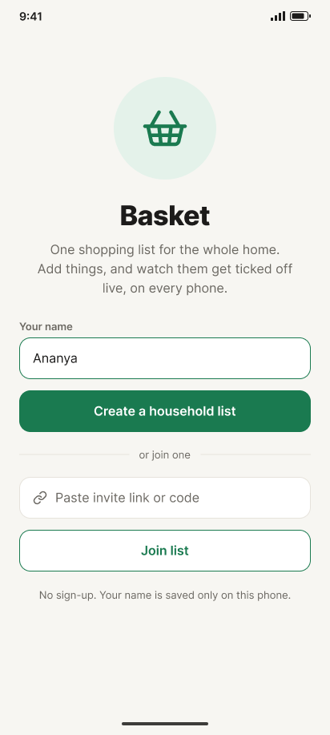
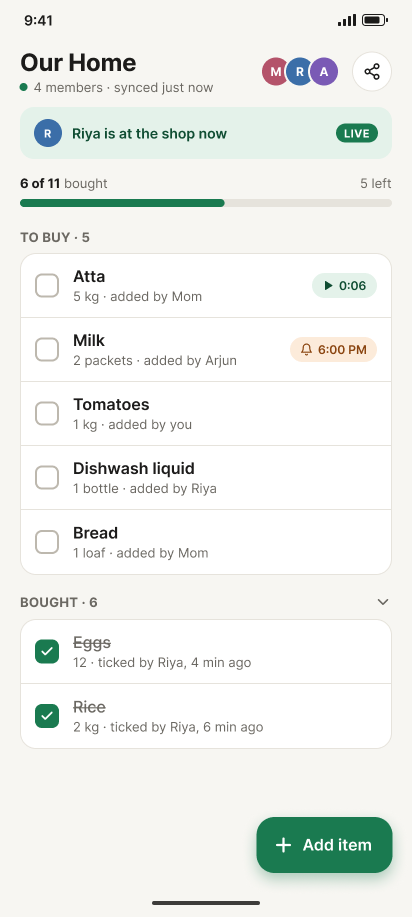
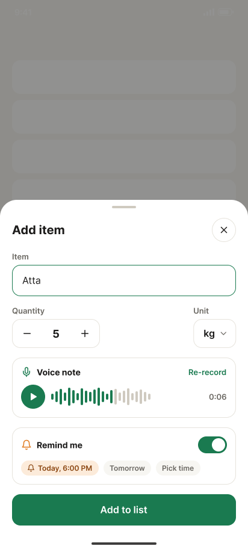
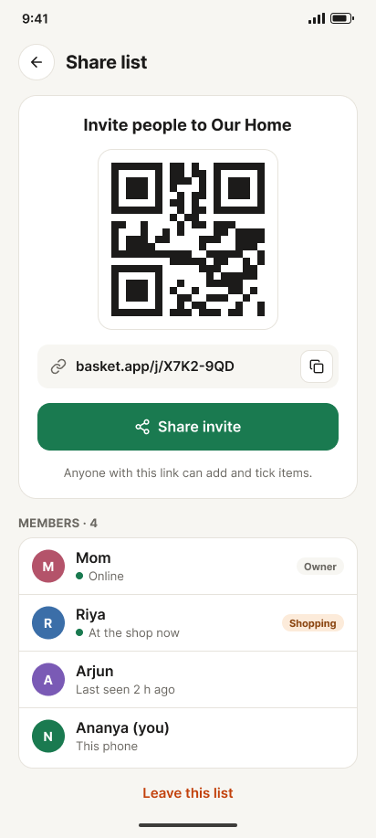

# Basket

**One shopping list for the whole home.** Add things, and watch them get ticked off live, on every phone.

Basket is a learning project: a small, real app built end to end to learn how a cross-platform mobile app is made. It's Android first, with iOS and web from the same code later.

> **Status:** the design is done. The app isn't built yet, and the tech stack is being chosen.

## Screens

| 1 · Welcome | 2 · List | 3 · Add item | 4 · Share & members |
|---|---|---|---|
|  |  |  |  |

## What each screen teaches

| Screen | What it does | What you learn building it |
|---|---|---|
| Welcome | Enter your name, then create a household list or join one with a link or code | Moving between screens, text input and buttons, saving data on the phone |
| List | The shared list: who's shopping right now, progress, voice-note and reminder chips | Live sync between phones, fast scrolling lists, showing who's online |
| Add item | A panel that slides up: item, quantity, a short voice note, "remind me at 6 PM" | Bottom sheets, recording and playing audio, scheduled phone notifications |
| Share & members | QR code, invite link, share button, members list | Deep links that open the right list, the phone's own share menu, building for Android and the web |

## Design

- **Tokens:** [`design/tokens.json`](design/tokens.json) holds the colours, type scale (Inter), corner radii and spacing. The app theme will be generated from it.
- **Token sheet:** [`design/screens/design-tokens.png`](design/screens/design-tokens.png).
- **Frames:** 412 × 917, Android's standard "compact" phone size.
- **Accessibility:** white on the primary green is about 5.3 : 1, and muted text on the background about 5.1 : 1. Both pass WCAG AA for normal text.

The screens were drafted as HTML and imported into Figma. To regenerate the mockup:

```bash
python3 design/mockup/make_html.py design/mockup/basket.html
```

## Roadmap

- [x] Screens and design tokens
- [ ] Choose the stack and set up the dev environment
- [ ] Screen 1: navigation, input, saving the name
- [ ] Screen 2: shared list with live sync and presence
- [ ] Screen 3: add item, voice note, reminder notification
- [ ] Screen 4: invite link, QR code, share sheet
- [ ] Android build (APK), then web, then iOS

## Repo layout

```
design/
  tokens.json        colours, type, radius, spacing
  screens/           exported screen images
  mockup/            HTML mockup and the script that generates it
```

## AI use

The design, mockup script and docs were drafted with help from an AI assistant (Claude) and reviewed by me.
